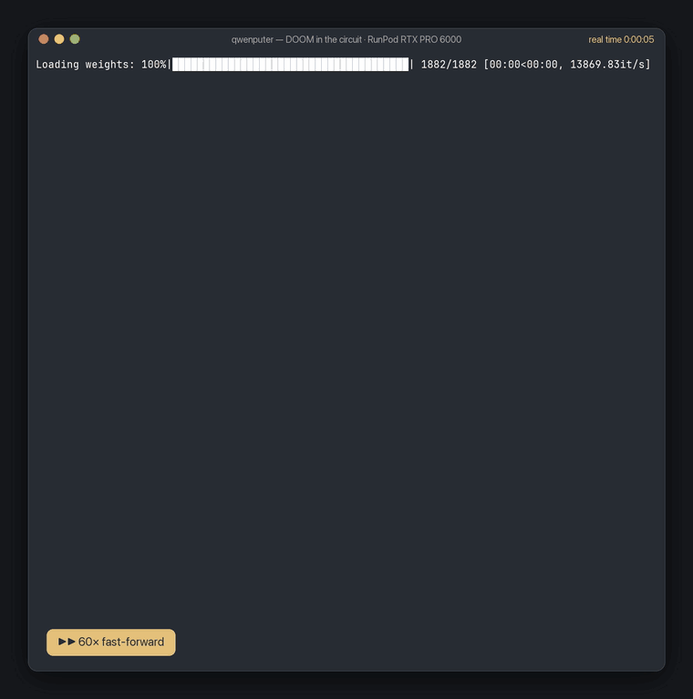

<p align="center">
  
</p>

Qwenputer model: [Hugging Face](https://huggingface.co/divagr1925/Qwen3.5-4B-Qwenputer) · [ModelScope](https://www.modelscope.ai/models/Spartan1925/Qwen3.5-4B-Qwenputer)  
Filesystem model: [Hugging Face](https://huggingface.co/divagr1925/Qwen3.5-4B-Qwenputer-Filesystem) · [ModelScope](https://www.modelscope.ai/models/Spartan1925/Qwen3.5-4B-Qwenputer-Filesystem)

**Qwenputer is a new kind of experimental model: Qwen3.5-4B with a 32-bit RISC-V CPU compiled and
inserted directly into its weights.** It isn't a plugin, a tool or a sandbox. The CPU is 11
transformer layers in front of Qwen's own, and none of their weights are learned: a compiler
computes every one.

It uses the model's own Gated DeltaNet state as RAM. Qwen3.5's DeltaNet layers carry a running
state that the delta rule can overwrite one row at a time, exactly, so each row works as a memory
cell. The CPU keeps its code, data, registers and program counter there.

The CPU runs C and MicroPython code inside the model's forward passes, and passes the official
riscv-tests suites.

<p align="center"></p>

## DOOM inside the circuit

<p align="center"><a href="docs/doom-in-the-circuit.mp4"></a></p>

<p align="center"><sub>A live session on a RunPod RTX PRO 6000 (<a href="docs/doom-in-the-circuit.mp4">MP4</a>). The waits are fast-forwarded and the badge says by how much; the real elapsed time is in the title bar. The 27 s clip covers 15 minutes.</sub></p>

Qwenputer runs **shareware DOOM** inside the model. It is id Software's engine,
[smunaut/doom_riscv](https://github.com/smunaut/doom_riscv) (a port of the GPL linuxdoom 1.10),
compiled to plain RV32IM with the shareware `DOOM1.WAD`. Every instruction of it is computed by
transformer layers compiled in front of Qwen3.5-4B. You ask Qwen to start DOOM, Qwen calls a
`doom` tool, and the game boots inside the model's layers and takes the terminal. No host code
executes a guest instruction.

What the video shows:

1. **The message is the entry point.** You type `start doom` in the raw harness, and Qwen calls
   the `doom` tool. The chip layers capture the call, wake the parked RV32 machine and boot
   DOOM. That is 3.4M circuit tokens, fast-forwarded 216× in the clip.
2. **The game takes the screen.** Once the guest starts drawing, the terminal gives the game its
   own screen, redrawn in place: the frame, the status line, what the circuit is doing, and
   Qwen's last line. Frames are 80 × 42 pixels in xterm colors (half blocks).
3. **Keys go to the game.** The clip presses `w w w`, `→ →`, `w w w w` and Space Space. Each
   batch of keys goes into the conversation as a `doom` tool call, and the circuit runs it the
   same way it runs Qwen's own calls: 4 game tics per key, then one rendered frame. That is
   about 0.5M circuit tokens a move, fast-forwarded about 20× in the clip.
4. **Tab returns to the chat**, with its scrollback untouched and a one-line summary. Tab again
   goes back to the game. The game screen is the one exception to the raw harness's
   no-alternate-screen rule.

```bash
./qwen-harness --doom      # needs doom_directory / doom_model in .qwenputer.local.json
```

Keys: `w a s d` or the arrows move and turn, `q e` strafe, Space fires, `u` opens doors, Esc
opens the menu, `1`–`7` pick weapons, Tab switches between the game and the chat, Ctrl-C stops a
move.

### How DOOM executes inside Qwen

- **The machine is layers.** The chip layers implement an RV32IM CPU: the fetch, decode,
  register file, ALU, branches, loads and stores. Gated DeltaNet heads hold the memory: 1 MB of
  RAM, 256 KB of code and 4 MB of read-only data (the WAD and the constants), one row per word,
  written by one-hot keys and read by one-hot queries. The MLP units do the arithmetic and the
  decoding.

  DOOM needs a wider build than the published checkpoint, the `doom` address map
  (`QWENPUTER_RV_MAP=doom`): 104 chip layers instead of 11, 1,591 heads and 42,137 MLP units.
  The default map and the published checkpoint are unchanged; for them the compiler emits the
  same circuit, node for node.
- **An instruction is about 1.6 tokens.** The CPU advances as the model generates tokens of its
  own vocabulary: one record per instruction, a value, a jump or a store. Each token is one full
  forward pass through the chip layers.
- **A tool call is a turn of the game.** The firmware ([`env/doom/`](experimental/riscv/chipformer/rv/env/doom))
  parks the machine between calls. When Qwen writes `</tool_call>`, the chip layers take over
  the next positions and the firmware runs:
  1. it reads the call's text (`keys`) from the text buffer;
  2. it runs 4 game tics per key and renders one frame;
  3. it emits the frame as `DSP` display tokens, which only the terminal reads;
  4. it emits a one-line `<tool_response>` for Qwen, e.g. `E1M1 alive health 100 armor 0
     pistol ammo 50 kills 0/6`;
  5. it parks again, and Qwen gets the position back.

  In play mode the terminal writes the call text for your keys, in place of Qwen choosing it.
- **Firmware.** `build.py` fetches doom_riscv at a pinned commit, applies `doom.patch`, and links
  it with:
  - a freestanding libc (`qlibc.c`): bump allocator, printf, WAD-only files, 64-bit division;
  - a platform loop (`qdoom.c`): the `I_*` hooks, the per-call game loop, and the color mapping
    from DOOM's palette to xterm colors.

  WAD lumps are read in place from read-only memory. Sound, music, demos and the screen melt
  are left out. The WAD is downloaded at build time (md5-checked) and never committed.
- **On the GPU**, Triton kernels evaluate the circuit's own tensor operations: each head's
  sparse projections, the one-row write and read of its state, and the MLP units. They do not
  interpret RISC-V. A separate RV32 interpreter is used only as a test oracle, and the circuit
  matches it token for token (see [Checks](#checks)).

### How it was optimized

The first live run took **105 minutes to start DOOM and 9 minutes per move**. It now takes
**7.2 minutes to start and about 80 s per move**, with the same instruction semantics and
token-for-token checks. There were two levers.

**1. Fewer guest instructions.** I profiled the firmware on the reference model: circuit tokens
per function, per call. Then I fixed what dominated:

| What the profile showed | Change | Tokens |
|---|---|---|
| 40% of the start went to linear lump-name scans (`W_CheckNumForName`, `strncasecmp`) | hash tables for lump and texture names, with the same precedence | about −5M |
| `R_InitTextureMapping` rescanned a 4,096-entry angle table for each column | one scan for all columns, right to left | −1.2M |
| Column lookups were built for all 125 textures, though E1M1 uses few | built the first time a texture is drawn | up to −0.8M |
| Sprite and sector setup looped over every name × every lump (or line) | one pass each, in the same order | −1.2M |
| `memset`/`memcpy` fell back to byte stores on unaligned buffers (a byte store is 4 tokens, a word 1) | align first, then word stores | start and moves |
| 39% of a move was floor spans on pixel rows the frame never shows | only the sampled rows are drawn; the texture coordinate is computed directly, bit-identical | most of the span work |
| Status bar, HUD and border copies for parts never shown | skipped while only the 3D view is up (palette flashes kept) | about −0.2M per move |
| Low-detail pixels written as two byte stores | one halfword store | about −50k per move |

Starting went from 12.4M to 3.3M circuit tokens, and moves from 1.0–1.3M to 0.35–0.8M (text
frames). Color frames add about 80–100k per move. On the reference model every 3D-view frame and
every Qwen reply equals the unmodified port's.

**2. Cheaper circuit tokens.** I profiled the executor in CUDA graphs on the RTX PRO 6000. It was
latency-bound: 27 fused steps, each a small kernel plus an `x += y` kernel, and one step (the
1,920-head RAM table) taking 183 µs. Per token in the graph:

| Change | µs per token |
|---|---:|
| Start (fused steps, device token loop) | 479 |
| Each step picks its fastest kernel variant (a program per value head or per key head), warp count and MLP block by timing | 249 |
| Weights exact in fp16 / indices in int16 stored at that width (fewer bytes; widened back, same arithmetic) | 211 |
| Programmatic dependent launch: each kernel loads its constant weights while the previous one finishes | 181 |
| Steps that read none of the dims they write add into the residual directly (no `x += y` kernel) | 148 |

Two changes outside the graph took the end-to-end rate from 5,158 to about 7,800 circuit
tokens/s:
- the device loop's decode and embedding became one fused kernel instead of about 20 small ops;
- the loop launches the next 256-token block before the host reads the current one.

I also tried a ring-buffer lag history to drop seven more kernels. It was slower (174 vs
148 µs), so it was removed. Every executor change was checked as exact before it was kept (see
below).

### Checks

- `doomcheck` runs the firmware on the reference RV32 model, which is a test oracle only.
- `execcompare` runs 14 executor configurations on 8,000 DOOM tokens and requires every residual
  value to equal the fp32 default.
- `doomexec` runs the GPU circuit and compares every token with the reference stream. With the
  color firmware, all of these matched:

  | call | circuit tokens | time | speed |
  |---|---:|---:|---:|
  | start | 3,422,126 | 442 s | 7,741 tok/s |
  | `w*2` | 556,185 | 75 s | 7,385 tok/s |
  | `d*3 f` | 632,153 | 85 s | 7,427 tok/s |

- `doomfixture` free-runs the compiled circuit on CPU and matched the reference for the first
  4,271 tokens of the start call (a bounded fixture).

### Hardware

The video and every number in this section come from one RunPod pod (Community Cloud):

| | |
|---|---|
| GPU | NVIDIA RTX PRO 6000 Blackwell Workstation Edition, 96 GB (driver 580, CUDA 12.8) |
| CPU / RAM | 96 vCPUs, 912 GB RAM |
| Disk | 120 GB; the merged checkpoint is 49 GB, Qwen3.5-4B is 8.8 GB |
| Software | Ubuntu 24.04, Python 3.12, PyTorch 2.8.0 (cu128), Triton 3.4.0, Transformers 5.21 |

- **GPU memory:** the merged checkpoint must fit on the GPU with room to spare, so a card with
  well over 49 GB of memory is needed. A 24 GB or 48 GB card is not enough.
- **Where things run:** the chip layers run on the Triton executor, which needs CUDA. The
  firmware build, the reference model and the offline fixtures run on a laptop.
- **Not tested:** other GPUs. Speed depends mostly on kernel launch latency and on how much of
  the chip weights stay in L2 cache.

### Replicate

1. **Build the firmware** on any machine with LLVM (clang with the RISC-V target, and `ld.lld`
   or `rust-lld`; set `RISCV_CLANG` / `RISCV_LLD` if they are not found). `build.py` fetches
   doom_riscv at the pinned commit and the shareware WAD (md5-checked), and writes `doom.elf`:

   ```bash
   cd experimental/riscv
   python chipformer/rv/env/doom/build.py        # -> chipformer/rv/env/doom/doom.elf
   QWENPUTER_RV_MAP=doom python -m chipformer.rv.doomcheck 'w*2'   # optional: reference run
   ```

2. **Prepare the GPU machine**: the repository, a virtual environment, Qwen3.5-4B, and
   `doom.elf` copied to the same path (it is not committed):

   ```bash
   cd experimental/riscv
   python3 -m venv .venv && .venv/bin/pip install torch==2.8.0 'transformers>=5.21' safetensors numpy
   huggingface-cli download Qwen/Qwen3.5-4B --local-dir /workspace/Qwen3.5-4B
   ```

3. **Merge the doom-map checkpoint**: Qwen3.5-4B with the 104 chip layers in front. The first
   run also caches the chip feature table (`chip_features.doom.npy`) next to it.

   ```bash
   QWENPUTER_RV_MAP=doom .venv/bin/python -m chipformer.rv.merge /workspace/Qwen3.5-4B --out /workspace/q4-doom
   ```

4. **Check the circuit** against the reference (optional, about 10 minutes):

   ```bash
   QWENPUTER_RV_MAP=doom .venv/bin/python -m chipformer.rv.doomexec --keys 'w*2' --keys 'd*3 f'
   QWENPUTER_RV_MAP=doom .venv/bin/python -m chipformer.rv.execcompare --tokens 8000
   ```

5. **Play**, in a terminal on the GPU machine. This is how the video was recorded:

   ```bash
   .venv/bin/python -m chipformer.rv.neural_harness --server --doom --model /workspace/q4-doom
   ```

   Or play from your laptop over SSH: put the remote in `.qwenputer.local.json` at the
   repository root and run `./qwen-harness --doom`. The keys are `ssh`, and optionally `key`,
   `port` and `known_hosts`; `doom_directory` (the remote's `experimental/riscv`); `python`
   (the remote venv's interpreter); and `doom_model` (the merged checkpoint).

6. **Record a video** (optional). `termrec` types a script into the harness and writes an
   asciicast. `castvideo` renders it as an MP4 with the fast-forward badges, using ffmpeg and
   Pillow:

   ```bash
   .venv/bin/python -m chipformer.rv.termrec play.cast --script steps.json --cols 100 --rows 40 -- \
       .venv/bin/python -m chipformer.rv.neural_harness --server --doom --model /workspace/q4-doom 2> play.log
   .venv/bin/python -m chipformer.rv.castvideo play.cast doom.mp4 --keys play.log
   ```

### Timing of the live session

Measured on a RunPod RTX PRO 6000:

- **Model load:** 2 min.
- **"start doom" end to end:** 7.2 min, nearly all of it circuit time.
- **Each move end to end:** 79–85 s. Of that, about 75 s is circuit time at 7,400–7,800
  circuit tokens/s.
- **Text decoding** was not timed separately. In play mode it is the 28-token tool call and
  the short tool response; Qwen does not comment on each move.

It plays turn by turn, not in real time.

## Benchmarks

Greedy decoding, 40 problems per set. Each row compares base Qwen3.5-4B and Qwenputer on the same
problems. Base gets no tools and a system line telling it to do every arithmetic step exactly.
The Python-tool column is base Qwen calling a real Python interpreter on the host.

| Benchmark | Base Qwen3.5-4B | **Qwenputer** | Python tool (host) |
|---|---|---|---|
| Synthetic integer arithmetic | 75.0 | **97.5** | 97.5 |
| DeepMind `mul_big` | 55.0 | **97.5** | 100 |
| DeepMind `div_big` | 72.5 | **97.5** | 95.0 |
| DeepMind `mul_div_multiple_longer` | 90.0 | **100.0** | 97.5 |
| DeepMind `add_or_sub_big` | 87.5 | **97.5** | 97.5 |

We replayed about 230,000 of the computer's output positions through a reference model of the
machine and found zero mismatches. Qwen's text behaviour matches
base: KL 6e-4, against a noise floor of 5e-4.

## Quickstart

```bash
git clone https://github.com/divagr18/qwenputer && cd qwenputer/experimental/riscv && uv sync --extra hf
hf download divagr1925/Qwen3.5-4B-Qwenputer --local-dir qwenputer-rv
uv run python -m chipformer.rv.chat qwenputer-rv --firmware tests/data/rv/calc-bridge.elf \
    --ask "Use calc: what is 123456789 * 987654321?"
```

Qwen uses the CPU entirely internally; it is not invoked through an external tool call. Instead,
it piggybacks on the tool-call format Qwen3.5 was trained on: Qwen writes a `<tool_call>` block for
`calc` exactly as it would for any tool, but nothing outside the model ever runs it. The computer
layers read the call, run it on the RISC-V CPU, and the model itself writes the `<tool_response>`,
digit by digit. No runtime, sandbox or tool executor is involved.

The model loads as a stock `Qwen3_5ForCausalLM`. The `RvChat` driver runs firmware startup through
the transformer layers, then restores its parked DeltaNet state after the prompt. It keeps the
CPU's trace tokens out of Qwen's language layers while decoding. Every token still comes from
the weights. A separate Triton circuit path measured about 3,200 trace tokens a second on an L4;
the current HF decoding changes have not yet been benchmarked on a GPU. Add `--check` to run
reference lockstep validation and replay.

The CPU is **RV32IM** with Zba and a bignum coprocessor. Its code lives in
[`experimental/riscv/`](experimental/riscv), and
[`experimental/riscv/docs/rv32.md`](experimental/riscv/docs/rv32.md) has the design and every
measurement.

## Raw neural harness

With a prepared remote connection in the ignored `.qwenputer.local.json`, launch with:

```bash
./qwenputer
```

This attaches directly to the remote raw-mode harness without reinstalling its environment.

```bash
./qwen-harness --demo
```

This opens an **offline neural-circuit fixture**, without loading pretrained Qwen weights.
It uses raw input and [Vercel fx](https://github.com/vercel-labs/fx)-style scrollback with
streaming output. Enter guest programs such as `: square dup * ;`, then `9 square .`.
The parser, definitions, stack and cells execute as RISC-V guest firmware in the compiled
neural circuit; the answer is 81.
`/help`, `/status`, `/new` and `/quit` control the terminal. Ctrl-C stops after the current
guest call and restores the previous guest state; Ctrl-D exits. Trace-budget failures also
restore the previous state. The terminal restores its settings on exit and on errors.

For an automatic bounded check, including defining and calling a tool in neural memory:

```bash
./qwen-harness --self-test
```

The self-test disables host RISC-V instruction execution and checks peak process memory
against a 768 MiB budget. It loads no language-model weights. The offline tests check its
sparse tensor lowering against the neural IR on every residual dimension and recurrent head.

The full Qwen conversation is a separate remote-only command:

```bash
./qwen-harness --ssh user@gpu-host
```

It checks the remote GPU and available RAM, uploads the source and firmware, prepares its
environment and starts the raw conversation. The full model is refused on macOS, on CPU,
or with insufficient GPU/host memory. The command never provisions cloud machines. Qwen
customizes its guest harness through the `harness` tool, and the guest dictionary and cells
persist across conversation turns in the circuit's recurrent state. The full pretrained
model has not been run for this offline test.

Guest firmware and its freestanding LLVM build script are in
[`experimental/riscv/chipformer/rv/env/harness/`](experimental/riscv/chipformer/rv/env/harness/).

## Gated DeltaNet as RAM

<p align="center"></p>

The computer's RAM is the state of Qwen3.5's own Gated DeltaNet layers. Qwen3.5 mixes full attention with these layers, and each DeltaNet head keeps a state matrix that it updates at every token with the gated delta rule (panel **a**). In the computer's heads the gate is held open (α = 1, so nothing fades) and the write strength is β = 1. Each key is a one-hot vector picking a single row, so every update replaces exactly that row with the value and leaves the rest untouched. That's a RAM write. A RAM read is the same head's query: a one-hot query returns exactly that row (panel **b**).

The rest is layout (panel **c**). The low bits of an address choose the head and the remaining
bits choose the row, and each row stores one byte as bits. The machine's memory is spread over a
few dozen heads, and its registers, program counter and call stack each get heads of their own.
Each key head drives two value heads, which doubles the capacity. The gate is useful too:
α = 0 for one token wipes a whole head (that's how the CHIP-8 screen is cleared), and α = ½ makes a head
halve every step, which the circuit uses as a counter.

Writes arrive through the token stream, so the trace is the computer's execution log. An `ADDR`
token names the row, the `VAL` token after it carries the value, and `STEP` ends the instruction.
Nothing here needed a new layer type: the computer's memory is the same Gated DeltaNet
recurrence Qwen3.5 already uses for language.

## In-weight filesystem (experimental)

The next logical step was to put a filesystem inside the weights. This is experimental and still
in progress: the model is up as
[`divagr1925/Qwen3.5-4B-Qwenputer-Filesystem`](https://huggingface.co/divagr1925/Qwen3.5-4B-Qwenputer-Filesystem)
(also on [ModelScope](https://www.modelscope.ai/models/Spartan1925/Qwen3.5-4B-Qwenputer-Filesystem)),
and its code lives on the [`rv-store`](https://github.com/divagr18/qwenputer/tree/rv-store/experimental/riscv)
branch for now.

It's the same RISC-V model with five more tools next to `calc`: `put`, `append`, `get`, `list` and
`delete`. When Qwen calls one, the compiled layers hash the file name to a slot in a directory kept
in DeltaNet state, so a lookup takes two or three trace tokens instead of a scan.

The file's text sits in other DeltaNet heads, eight tokens to a row, and the layers print it back into the
`<tool_response>` token for token. It holds up to 512 files, about 53,000 tokens of text. Save
those heads at the end of a conversation, load them at the start of the next one, and the files
are still there.

| Benchmark | Base Qwen3.5-4B | **Qwenputer Filesystem** | Python tool (host) |
|---|---|---|---|
| Multi-session recall, 90 questions | 7.8 | **83.3** | 78.9 |
| Facts that changed in a later session, 30 questions | 3.3 | **90.0** | 83.3 |

The model card has the quickstart and the full results.

## Version 1 (CHIP-8)

[`divagr1925/Qwen3.5-4B-Qwenputer-CHIP8`](https://huggingface.co/divagr1925/Qwen3.5-4B-Qwenputer-CHIP8)
is the first Qwenputer. It compiles a CHIP-8 machine into Qwen3.5-4B instead: a CPU, a big-number
maths library and its memory, written as transformer layers and appended to the stock model. Its
code is at the top level of this repo (`chipformer/q35/`).

When the CHIP-8 model writes `48213 × 9917 =`, the answer isn't a guess. The computer in its
weights runs the multiplication, and the model writes `478128321` itself, digit by digit, exactly.
It has never printed a wrong answer, from 3-digit sums to 20-digit products, and it still loads
like any other Qwen checkpoint.

<details><summary>CHIP-8 benchmarks</summary>

These are Qwen3.5-4B scores, greedy decoding. Each row compares base Qwen and the CHIP-8 model on
the same problems. The Python-tool column is base Qwen calling a real
Python interpreter on the host, which is the ceiling for this kind of help.

| Benchmark | Base Qwen3.5-4B | **Qwenputer CHIP-8** | Python tool (host) |
|---|---|---|---|
| NUPA integer add / sub / mul, 3-20 digits (576) | 48.6 | **100.0** | 100.0 |
| DeepMind arithmetic, 6 sets pooled (600) | 80.8 | **92.3** | 94.2 |
| DeepMind `div_big` (100) | 77 | **97** | 85 |
| DeepMind `mul_big` (100) | 66 | **93** | 91 |
| DeepMind clean big add / mul (200) | 69.5 | **99.0** | 98.5 |

The computer has never printed a wrong result. We replayed about 3.9 million positions of model
output through a reference simulator of the circuit and found zero mismatches. MMLU: 71.9 vs 71.7 for base (99% identical answers, KL 7e-4).

It does not help everywhere. GSM8K and GSM-Hard are ties, because word problems are limited by
reasoning rather than arithmetic. On the long DeepMind expression chains (`mixed_longer`,
`mul_div_multiple_longer`) base Qwen is still ahead. Qwen tends to re-verify exact results it
has already been given, until it runs out of its token budget, and the next release targets
this.

These numbers are the best mode per benchmark across our development checkpoints. The
released checkpoint contains all the features behind them, and its own full sweep will replace
this table.

</details>

### How it works

```
Qwen writes        "48213 × 9917 ="
computer layers    read the digits, run the BIOS, emit trace tokens
the model prints   " 478128321"
Qwen continues     as if it had written the number itself
```

**Running.** Each generated trace token is one write to the computer's memory (see
[Gated DeltaNet as RAM](#gated-deltanet-as-ram)). A few tokens make one
instruction, so the trace is the machine's execution log. The MLPs do the arithmetic as exact
lookup tables, and every value stays exact in bf16.

**The bridge.** The computer layers sit before Qwen's and read Qwen's tokens: digits, operators,
tool-call tags. When a calculation is complete they run it and print the answer as normal text.
Qwen's state is frozen while the computer runs.

**What it can do.** The computer is about 0.7M nonzero weights covering add, subtract, multiply, exact division
(reduced fractions when it doesn't terminate), signed numbers, mod, gcd, and whole expressions with
brackets, powers and decimals. Stock checkpoints give
every layer the same width, so the merged model is 14.65 GB vs 9.3 GB for base Qwen. The extra is
almost all zeros, so the download is about the same size.

More in [`docs/`](docs): the architecture ([`q35.md`](docs/q35.md)), the arithmetic library
([`q35-skills.md`](docs/q35-skills.md)), an exact in-weights object store
([`q35-store.md`](docs/q35-store.md)) and shrinking the checkpoint
([`q35-size.md`](docs/q35-size.md)).

### Is there really no tool call?

There is no tool. Qwen can ask for a calculation in two ways, and in neither case does anything
outside the model see it.

It can write the calculation inline, as it would in any answer: `48213 × 9917 =`. The model then
continues with ` 478128321`.

It can also use the tool-call syntax it was trained on, writing `<tool_call><function=mul>…`.
Nothing intercepts that. No runtime parses it and no server executes it. The `<tool_response>`
that follows, with the exact product inside, is predicted by the model's own layers, token by
token, exactly as it predicts every other token.

You can check this yourself: the checkpoint runs under stock `model.generate()` with no tools
registered, no stopping criteria and no callbacks. The computer's work is visible in the token
stream, as a burst of special "trace" tokens. These are the machine's execution log, and Qwen
then reads the printed answer like ordinary text.

### CHIP-8 quickstart

```bash
git clone https://github.com/divagr18/qwenputer && cd qwenputer
uv sync --extra hf
hf download divagr1925/Qwen3.5-4B-Qwenputer-CHIP8 --local-dir qwenputer-4b

uv run python -m chipformer.q35.demo qwenputer-4b                   # Qwen uses its tool-call syntax
uv run python -m chipformer.q35.demo qwenputer-4b --inline --nudge  # plain inline arithmetic
```

Under the hood every prompt starts with the computer's BIOS. That's a boot record of chip
tokens, which puts the arithmetic library into the computer's memory, followed by Qwen's normal
chat template. After that it's a plain `generate()` call:

```python
import json, torch
from transformers import AutoModelForImageTextToText, AutoTokenizer
from chipformer.q35.demo import TOOLS
from chipformer.q35.lib import bcd
from chipformer.ref.emu import Chip8
from chipformer.trace import boot_tokens

torch.backends.cuda.matmul.allow_bf16_reduced_precision_reduction = False  # keep matmuls exact

path = "qwenputer-4b"
tok = AutoTokenizer.from_pretrained(path)
model = AutoModelForImageTextToText.from_pretrained(path, dtype=torch.bfloat16, device_map="cuda")
off = json.load(open(f"{path}/chipformer.json"))["chip_token_offset"]
bios = [t + off for t in boot_tokens(Chip8(bcd.ROM, bcd.QUIRKS).cells)]

msgs = [{"role": "user", "content": "What is 48213 * 9917?"}]
ids = bios + tok.apply_chat_template(msgs, tools=TOOLS, add_generation_prompt=True,
                                     enable_thinking=False)["input_ids"]
out = model.generate(torch.tensor([ids], device="cuda"), max_new_tokens=4096, do_sample=False,
                     cache_implementation="static")
print(tok.decode(out[0, len(ids):], skip_special_tokens=True))
```

The model needs no custom modelling code. [`docs/running.md`](docs/running.md) covers the
details:
- the tools and system prompts that work best
- the generation settings shipped in `generation_config.json`
- the optional decoder settings our benchmarks used (`fp` and `tc` in `BatchDecoder`), which make
  inline mode stronger

## Citing

If you use Qwenputer in your work, please cite it. GitHub's "Cite this repository" button reads
[CITATION.cff](CITATION.cff); in BibTeX:

```bibtex
@software{agrawal2026qwenputer,
  author  = {Agrawal, Divyansh},
  title   = {{Qwenputer}: a computer compiled into the weights of a pretrained language model},
  year    = {2026},
  version = {0.1.0},
  url     = {https://github.com/divagr18/qwenputer},
  license = {MIT}
}
```

## License

The code is MIT. The model weights are Apache-2.0, as a modified version of
[Qwen/Qwen3.5-4B](https://huggingface.co/Qwen/Qwen3.5-4B): the config is widened and computer
layers are added, but Qwen's own weights are unchanged.
